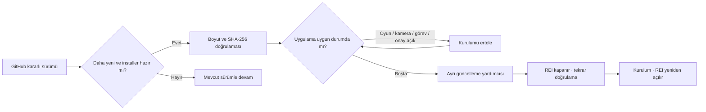
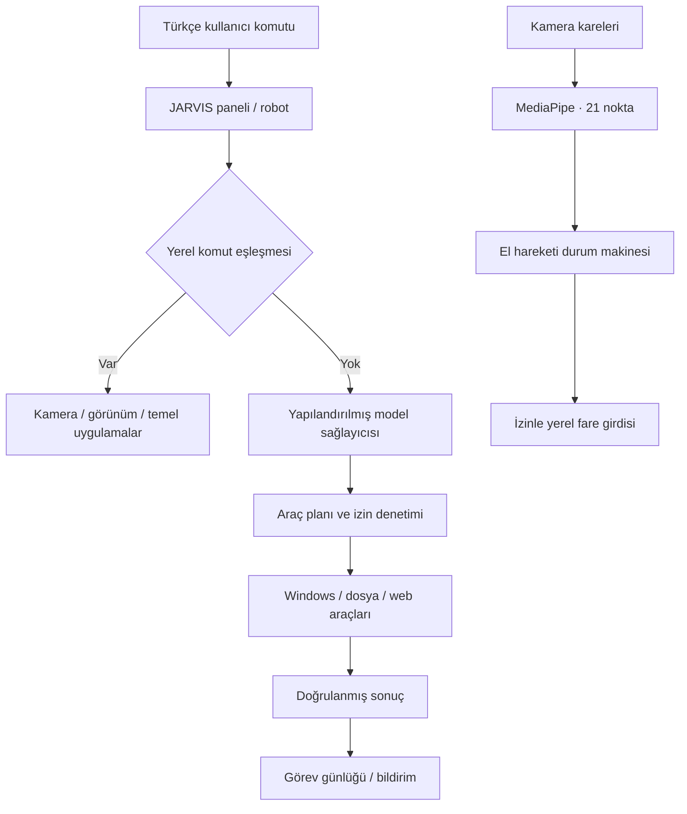

<p align="center">
  
</p>

<p align="center">
  <a href="https://github.com/jagwey/rei-releases/releases"><strong>Sürümleri indir</strong></a> ·
  <a href="#hızlı-başlangıç">Başlangıç</a> ·
  <a href="#el-hareketleri">El hareketleri</a> ·
  <a href="#türkçe-komutlar">Komutlar</a> ·
  <a href="progres.md">Geliştirme kaydı</a>
</p>

# REI 3.0.2

**REI**, Windows 11 için yerel Python/PySide6 ile geliştirilmiş %100 Türkçe kişisel masaüstü yapay zekâ asistanı, komuta merkezi, 60 FPS kamera/el kontrolü ve **Kaedehara Kazuha** masaüstü maskotu uygulamasıdır. Tarayıcı kısayolu değil; doğrudan Windows masaüstünde çalışan gerçek bir yerel `.exe` uygulamasıdır.

Kaynak kod özel `jagwey/rei` deposunda tutulur. Herkese açık
[dağıtım deposunda (`jagwey/rei-releases`)](https://github.com/jagwey/rei-releases) yalnızca imzasız derlenmiş Windows uygulama
paketleri (`REI-Setup-X.Y.Z.exe`, `REI-Portable-X.Y.Z.zip`), eşlikçi APK, doğrulama kayıtları ve dağıtım belgeleri yayımlanır. [Yayın düzeni](docs/DISTRIBUTION.md).

## Son Sürüm: REI 3.0.2 (Kararlı / Latest)

- **Kaedehara Kazuha Masaüstü Maskotu ve Uygulama İkonu:** 13 animasyon grubu ve `combined-56-frames.png` üzerinden 56 özgün piksel kare (`idle`, `walk`, `run`, `talk`, `think`, `sleep`, `wind_jump`, `fall`, `plunge`, `glide`, `climb`, `burst`, `leaf_flute`). `wind_jump` (Chihayaburu E yeteneği) 5 aşamalı rüzgâr yükselişi ve inişiyle pencere konumunu hareket ettirir; `FastTransformation` ile net piksel çizimi korunur, varsayılan boy `88 px` olup Ayarlar → Karakter bölümünden değiştirilebilir. Pencere, görev çubuğu, sistem tepsisi ve Windows kurulum simgelerinin tamamı `kazuha.ico` kullanır.
- **%100 Türkçe Arayüz ve Kurulum:** Ana çalışma alanı, HUD kontrol paneli, sağ tık/tepsi menüleri, ayar sekmeleri (`1.345` Türkçe katalog girişi), Google/API bağlantıları ve Türkçe Inno Setup kurulum sihirbazı.
- **60 FPS Hızlı Kamera ve El Kontrolü:** Hıza duyarlı adaptif `OneEuro` filtresi (`beta=0.25`), hızlı el hareketlerinde ölü bölge atlama, 1–2 kare kayıp/hareket bulanıklığı telafisi ve **Hızlı / Dengeli** takip modu seçimi. Kamera görüntüsü yerel bellek dışına veya buluta gönderilmez.
- **Google, Mesajlaşma, Medya ve Ajan Bağlantıları:** Google Takvim/Gmail/Drive/Kişiler/Tasks, Spotify PKCE, YouTube Music, Discord, Telegram, WhatsApp Web, X, GitHub, Android eşlikçi köprüsü (`REI-Android-3.0.2.apk`), yerel OpenJarvis (`/health` + yerel LLM) ve Claude Code, Codex, Cursor, OpenCode, Gemini, Groq, OpenRouter, Ollama desteği.

**İndirme (`v3.0.2`):**
- Kurulum sihirbazı: [`REI-Setup-3.0.2.exe`](https://github.com/jagwey/rei-releases/releases/download/v3.0.2/REI-Setup-3.0.2.exe)
- Taşınabilir ZIP: [`REI-Portable-3.0.2.zip`](https://github.com/jagwey/rei-releases/releases/download/v3.0.2/REI-Portable-3.0.2.zip)
- Android eşlikçi: [`REI-Android-3.0.2.apk`](https://github.com/jagwey/rei-releases/releases/download/v3.0.2/REI-Android-3.0.2.apk) (SHA-256: `dd0257b4250dcd16906aaae75a34f8ccf0439c6af6edceb3b6bd0e638490c03e`)
- Doğrulama & SHA-256: [`verification.txt`](https://github.com/jagwey/rei-releases/releases/download/v3.0.2/verification.txt) · [`SHA256SUMS.txt`](https://github.com/jagwey/rei-releases/releases/download/v3.0.2/SHA256SUMS.txt)
- Sürüm sayfası ve notlar: [`v3.0.2` Release (`jagwey/rei-releases`)](https://github.com/jagwey/rei-releases/releases/tag/v3.0.2) · [3.0.2 sürüm notları](docs/RELEASE-3.0.2.md)

> Taşınabilir `REI-Portable-3.0.2.zip` arşivini tamamen çıkartıp `REI/REI.exe` dosyasını aç ve `_internal` klasörünü yanında tut; kurulum/güncelleme öncesinde varsa eski REI sürecini tepsi simgesinden kapat. Python kurulumu gerekmez.


[Uygulama ve doğrulama kaydı](docs/PLATFORM_REBUILD.md) ·
[El motoru ve ölçümler](docs/PLATFORM_VISION.md) ·
[Robot kapsamı](docs/PLATFORM_ROBOT.md) ·
[Yol haritası](docs/ROADMAP.md).

## 1.2.0 · tek yönetim merkezi

**Yönetim merkezi** düğmesi: kodlama ajanları/projeler, görev kuyruğu ve iptal,
hesap/telefon kurulum yerleri, kullanım sınırları, kaynak ölçümü, hafıza ve acil durdurma.
Hesapları daha sonra bağlayabilirsin; anahtarlar sohbetten istenmez.

- Codex/Claude/Cursor/OpenCode mevcut CLI oturumunu kullanır; iki görev paralel
  yürür. Codex/Claude düzenlemeleri ayrı Git worktree'de kalır, otomatik merge yoktur.
- Windows UIA ile denetim gözlemi ve hedefli eylemler; ayrı Brave profilinde
  sekmeler, sayfa/denetim okuma, locator ile tıklama/doldurma. Şifre/çerez okuma yoktur.
- Günlük token ve tahmini USD sınırı; yalnızca meta veri kaydı. Fiyatları kullanıcı
  girer; CLI ajan faturaları ayrıca kendi sağlayıcısındadır.
- Android 1.1: USB veya sertifika eşleştirmeli TLS kablosuz bağlantı. İsteğe bağlı
  erişilebilirlik ajanı, ekranda gözlemlenmiş hedefler ve telefonda işlem onayı.
- Telegram/Discord gelen `/rei` komutları isteğe bağlı ve izinli göndericilerle
  sınırlıdır; başlangıçta kapalıdır. WhatsApp kişisel hesap için Web/taslak desteğidir.
- Yeni kurulum hafif API-first OpenRouter free profilidir; büyük yerel model
  yüklenmez. Mevcut sağlayıcı ve hesap ayarları korunur.

Bu sürümün gerçek hesap, cihaz ve uzun kullanım testleri kullanıcıya bırakılmıştır.
[1.2 notları](docs/RELEASE-1.2.0.md) · [güncel ilerleme](docs/PROGRESS.md).


Güncel geliştirme: [ilerleme](docs/PROGRESS.md) · [mimari](docs/ARCHITECTURE.md) ·
[altı faz](docs/ROADMAP.md) · [güvenlik](docs/SECURITY.md) ·
[açık kaynak seçimleri](docs/OPEN_SOURCE_REFERENCES.md).

Kararlı 1.2 HUD'da şu komut desteklenir (2.0 çalışma alanında ayrı kısayol olarak taşınmadı; CLI yolu korunur):
**“Rei, Brave'i aç, GitHub profilime git ve bilgisayarımdaki REI projesinin klasörünü göster.”**
Oturumluk Tam bilgisayar erişimi açıkken sabit yerel akış çalışır; model/API
çağrısı yapmaz. Proje kaynağı bulunamazsa klasör sorulur. Süreç başlatma sonucu
pencerenin/sayfanın hazır olduğu iddiasıyla sunulmaz. REI 1.2.0 paketine dahildir.

CLI önizlemesi: `python -m rei quick "Brave'i aç ve GitHub profilime git" --project .`.
Uygulamak için `--execute`; GitHub sahibi checkout'tan okunamazsa `--github-profile KULLANICI`.

**Windows'ta çalışma alanı ve piksel maskotu; bilgisayara bağlanan Android uygulamasıyla telefonda kişisel ajan.**

Güncelleme kontrolü: Ayarlar → Bilgi ve güncelleme bölümünden yüklü sürümü
görebilir, GitHub'daki yeni sürümleri elle kontrol edebilirsin. Otomatik kontrol
açıksa REI açıldığında da kontrol eder; yeni sürüm bildirilir.

Windows sürümü [v1.2.0](https://github.com/jagwey/rei/releases/tag/v1.2.0), Android sürümü
[1.1.0](https://github.com/jagwey/rei/releases/tag/android-v1.1.0).
Dosya/uygulama araçları, ses sağlayıcıları, görev geçmişi ve oyun modu masaüstünde bulunur.
Kamera ve el hareketlerinin gerçek donanımdaki davranışı cihazına göre ayrıca doğrulanmalıdır.

## Android ve hesap bağlantıları

- **Sohbet, Görevler, Bağlantı:** telefondan bilgisayardaki seçili ajanla konuş; yanıt akışını ve araç adımlarını izle.
- Bağlantı kopunca yeniden bağlanma kartı otomatik açılır; sohbet ve eşleştirme korunur. Belirsiz görevler kendiliğinden tekrarlanmaz.
- İşlem onayları ilgili mobil görev için telefonda gösterilir. Bilgisayarın erişim modu korunur.
- Önemli görev sonuçları, hatalar ve onaylar için isteğe bağlı Android bildirimleri; değişmeyen durumlar sessizdir.
- Telefonda GitHub güncelleme kontrolü, doğrulanmış APK indirme ve Android'in kurulum ekranı. Aynı imzayla güncelleme verileri korur.
- Bilgisayarda **Dil: Türkçe / Language: English** menü seçenekleri ve ayarlarda Türkçe/English seçimi.
- Google Tasks/Kişiler okuma, Spotify PKCE bağlantısı, Telegram/Discord bot araçları, WhatsApp Web ve onaylı Android USB araçları.

Android için bilgisayarın ve Rei'nin açık olması gerekir. Yetkili USB bağlantısı veya
sertifika özetiyle eşleştirilmiş özel ağ/VPN üzerinden TLS kullanılabilir.
API anahtarları bilgisayarda kalır; telefona veya GitHub'a kopyalanmaz. Hesap bağlantıları ayrıca kurulmalıdır;
uygulamayı yüklemek tüm hesaplara kendiliğinden erişim vermez. Gemini API veya ücretli servis etkinleştirilmez.

**Kurulum:** Windows 1.2.0 kurulum paketini bilgisayara, [Android sürümündeki](https://github.com/jagwey/rei/releases/tag/android-v1.1.0) APK'yı
telefona kur. Bağlantılar Windows paketine dahildir; ayrıca eklenti yüklemek gerekmez.
Yönetim merkezi → Hesaplar ve telefon bölümünden eşleştirmeyi aç.
[Eşleştirme, bildirimler, güncellemeler ve derleme](docs/ANDROID.md) ·
[Hesap bağlantıları ve desteklenen izinler](extensions/rei_connections/README.md).
Android sürümleri ayrı `android-vX.Y.Z` etiketlerini kullanır; Windows güncelleme kanalı ayrı kalır.

### HUD ana ekranı

Şehir arka planı, camgöbeği cam paneller, canlı saat ve animasyonlu merkez.
CPU, RAM, disk, ağ hızı ve pil değerleri yerel sistemden okunur; ekran gerçek Qt
uygulamasıdır. Seçilen maskot ve gerçek sistem verileri uygulamaya bağlıdır.


## Neler yapabilirsin?

### JARVIS paneli ve piksel maskot

- Animasyonlu kontrol merkezi, Türkçe menüler, yazılı komut alanı ve görev durumu.
- v1.1.2 HUD: canlı saat/tarih, gerçek CPU/RAM/disk/ağ/pil göstergeleri. Konum,
  hava veya GPU ölçümü bağlı değilken bu alanlarda uydurma değer gösterilmez.
- **Maskot görünümü** düğmesiyle masaüstü karakterine geçiş. Sistem tepsisindeki
  **JARVIS kontrol paneli** seçeneğiyle panele dönüş.
- Ayarlar, dosyalar, zamanlanmış görevler ve görev geçmişine hızlı erişim.
- Görev sonuçlarının REI günlüğüne aktarılması ve tepsi bildirimleri.

<p align="center"></p>

- **Kaedehara Kazuha 13 animasyon, 56 kare:** `idle` (bekleme/göz kırpma), `walk` (yürüme), `run` (koşma), `talk` (konuşma), `think` (düşünme), `sleep` (uyuma), `wind_jump` (Chihayaburu E yeteneği — 5 aşamalı kısa rüzgâr yükselişi ve iniş), `fall` (serbest düşme), `plunge` (Midare Ranzan dalışı), `glide` (planörle süzülme), `climb` (tırmanma), `burst` (Kazuha Slash) ve `leaf_flute` (yaprakla çalma).
- `desktop/resources/mascot/combined-56-frames.png` (8×7 ızgara, 128×128 şeffaf piksel kareler) ve `manifest.json` süre/döngü tanımları doğrudan kullanılır; tek seferlik hareketler sonsuz döngüye girmez.
- Sağ tık ve tepsi menüsündeki **Animasyon önizleme** ile 13 hareketin tamamı sırasıyla önizlenebilir; önizleme görev başlatmaz.
- Konuşma TTS oynarken, düşünme yanıt hazırlanırken, koşma/yürüme hareket ederken, düşüş/iniş sürüklenip bırakıldığında, uyku uzun hareketsizlikte otomatik etkinleşir; varsayılan karakter boyu **88 px** olup **Ayarlar → Karakter** üzerinden değiştirilebilir.
- [Görsel kaynak ve atlas bilgileri](desktop/ASSETS.md).

### Kamera ve el ile fare kontrolü

- MediaPipe/OpenCV ile 60 FPS hedefli, iki ele kadar, el başına **21 nokta** takibi.
- Hıza duyarlı adaptif `OneEuro` filtresi (`beta=0.25`), hızlı hareketlerde ölü bölge atlama ve 1–2 kare kayıp/hareket bulanıklığı telafisi.
- Kontrol panelinde **Takip Modu (`Hızlı` / `Dengeli`)**, **Yumuşatma** kaydırıcısı, **El Kontrolü** ve **Kamera Önizleme** anahtarları.
- İmleç, sol/sağ tık, çift tık, sürükleme, kaydırma, duraklatma ve devam.
- Kamera başlangıçta kapalıdır. Fare kontrolü ayrıca açılır. **F8 ikisini de durdurur.**
- Bu el takibi yolu kamera karelerini dosyaya yazmaz ve buluta göndermez.

### Bilgisayar işlemleri

- Dosya okuma/listeleme/arama ve mevcut masaüstü araçları.
- Uygulama açma, ekran/uygulama gözlemi ve modelin planladığı araç görevleri.
- **Tam bilgisayar erişimi**, bu oturum için Windows hesabının dosya ve uygulama
  araçlarını açar. Silme, mevcut dosyanın üzerine yazma ve dışarıya gönderme gibi
  işlemler ayrıca hedef gösterilerek onaylanır.
- Bu seçenek yönetici yetkisi vermez. Bazı eski hızlı komutlar ve güvenilen
  eklentiler kendi izin kontrollerini kullanır; ayrıntı [entegrasyon belgesinde](docs/ARI_INTEGRATION.md).

### Türkçe ses ve model seçenekleri

- Türkçe arayüz ve `tr-TR` ses tanıma varsayılanları.
- Çevrimiçi Edge TTS için **Ahmet / Emel** ses seçenekleri; isteğe bağlı yerel ses adaptörleri.
- Ollama ve API sağlayıcıları için mevcut bağlantı katmanları.
- Qwen3 14B bir hedef seçenektir; otomatik indirilmez. Çalışması için mevcut model
  sunucusu veya seçtiğin API yapılandırılmalıdır. Metin modeline ekran görme özelliği atfedilmez;
  ekran analizi ayrı bir görsel model gerektirir.
- Yerel/API seçenekleri, her hatada otomatik ve izinsiz buluta geçiş anlamına gelmez.

### Oyun modu ve güncellemeler

- Oyun modu kamerayı ve el kontrolünü kapatır; görev/bildirim akışının müdahalesini azaltır.
- Güncelleme kurulumu oyun, kamera, açık onay veya çalışan görev sırasında ertelenir.
- Kurulu uygulama kendi GitHub Releases kanalını kontrol eder; sürüm, dosya adı,
  boyut ve SHA-256 doğrulanmadan installer çalıştırmaz.
- Otomatik kontrol ve kurulum ayarlardan kapatılabilir. Portable sürüm kendi kendine kuruluma dönüşmez.

## Hızlı başlangıç

1. [Releases](https://github.com/jagwey/rei-releases/releases) sayfasından yayımlanmış
   sürümün **`REI-Setup-X.Y.Z.exe`** dosyasını indir. v1.1.0 kaynak sürümüdür, EXE içermez.
2. Türkçe kurulum sihirbazıyla REI'yi kendi kullanıcı hesabına kur ve aç.
3. İlk olarak `hesap makinesini aç` veya `kamerayı aç` gibi model gerektirmeyen bir komut dene.
4. Gelişmiş doğal dil görevleri için **Ayarlar → Yapay zekâ ayarları** bölümünden
   mevcut yerel modelini veya API sağlayıcını yapılandır.
5. Bilgisayarda işlem yaptırmak istediğinde panelde **Tam bilgisayar erişimi** seçeneğini aç.
6. El ile kontrol için önce **Kamerayı aç**, ardından **El hareketleriyle fareyi kontrol et** seçeneğini aç.

Kurulum; Python geliştirme ortamı, Ollama, Qwen3 14B veya bir başlangıç servisi kurmaz.
Masaüstü kısayolu isteğe bağlıdır. Paket için kod imzalama sertifikası henüz yapılandırılmamıştır.

## El hareketleri


1. **İmleç:** işaret parmağını uzat, orta/yüzük/serçe parmaklarını kapat. Parmağını kadrajda hareket ettir.
2. **Sol tık:** başparmak ile işaret parmağını kısa süre kıstır, sonra ayır. Tıklama ayırdığında oluşur.
3. **Çift tık:** iki kısa kıstırmayı Windows'un çift tık süresi içinde tekrarla.
4. **Sürükle:** başparmak–işaret kıstırmasını yaklaşık **0,6 saniye** tut, hedefi taşı, parmaklarını ayırarak bırak.
5. **Sağ tık:** başparmak ile orta parmağını kıstır ve ayır; başparmak–işaret kıstırması açık kalsın.
6. **Kaydır:** işaret ve orta parmağı uzat, diğer iki parmağı kapat; elini yukarı/aşağı hareket ettir.
7. **Duraklat:** açık avucunu yaklaşık **0,8 saniye** tut.
8. **Devam:** yumruğunu yaklaşık **0,8 saniye** tut.
9. **Acil durdur:** klavyeden **F8**. Kamera ve el kontrolü kapatılır; uygulama açık kalır.

**İlk deneme:** kameraya dönük, iyi aydınlatılmış tek el kullan. İki el algılanabilir;
fareyi ilk izlenen el yönetir. **İmleç tepkisi** arttıkça takip daha hızlı, azaldıkça daha
yumuşak olur. El kaybolursa uygulamanın tuttuğu sürükleme bırakılır. Oyun modu kamerayı kapatır.

[Ayrıntılı el kontrolü rehberi ve sorun giderme →](docs/HAND_CONTROL.md)

## Türkçe komutlar

### Model gerektirmeyen yazılı komutlar

Bu komutlar panelde tam eşleşmeyle yerel olarak işlenir. Başlarına `REI `,
`Rey ` veya `Jarvis ` eklenebilir; örneğin **`Jarvis kamerayı aç`**.

- **Kamera:** `kamerayı aç` · `kamerayı kapat`
- **El ile fare:** `el kontrolünü aç` · `el kontrolünü kapat`
- **Görünüm:** `maskot moduna geç` · `robot moduna geç` · `jarvis moduna geç` · `kontrol panelini aç`
- **Ayarlar ve dosyalar:** `ayarları aç` · `dosyalarımı aç`
- **Oyun:** `oyun modunu aç` · `oyun modunu kapat`
- **Görevler:** `görev geçmişini göster` · `görevleri göster`
- **Uygulamalar:** `not defterini aç` · `hesap makinesini aç`

Bu küçük komut tanıyıcı bütün Türkçe cümleleri anlamaz. Birden çok işlem veya
serbest anlatım, model bağlantısı gerektiren gelişmiş komut yoluna gider.

### Model / araç bağlantısı gerektiren örnekler

```text
Açık uygulamalarımı göster.
Belgeler klasörümdeki PDF dosyalarını listele.
Seçtiğim dosyanın içeriğini özetle.
Ekrandaki hatayı incele.       → görsel model de gerekir
Bu işi zamanlanmış görev yap. → ilgili görev aracı gerekir
```

Bunlar kullanım örnekleridir; her sağlayıcı ve araçla uçtan uca doğrulanmış
işlem garantisi değildir. Mail için ayrıca OAuth/hesap bağlantısı gerekir.
**Durdur** düğmesi çalışan yanıt/görev için iptal isteği iletir.

[Komutların kapsamı ve bağlantı koşulları →](docs/COMMANDS.md)

## Ayarlar


Model/API sağlayıcısı, ses, mikrofon, görünüm ve güncelleme seçenekleri ayarlardan yönetilir.
Kamera kullanmak için API gerekmez. Çevrimiçi STT/TTS seçersen ses veya konuşulacak
metin ilgili sağlayıcıya iletilir; bu durum el takibindeki yerel kamera işleyişinden ayrıdır.

## Otomatik güncelleme nasıl çalışır?



Yalnızca `jagwey/rei-releases` deposundaki kararlı sürümler kabul edilir. Kaynak-only
sürümler, tamamlanmamış yüklemeler ve daha eski/eşit sürümler kurulmaz.
Başarısız bir sürüm otomatik olarak tekrar tekrar denenmez.

## Veriler nerede tutulur?

- **Uygulama:** `%LOCALAPPDATA%\Programs\REI`
- **Ayarlar ve çalışma verisi:** `%APPDATA%\REI`
- **Kaynak geliştirme ortamı:** `.rei_runtime` veya açıkça verilmiş `REI_APP_DATA_DIR`
- Güncelleme ve normal kaldırma kullanıcı ayarlarını elle silmez.
- Eski Ari veri klasörü otomatik okunmaz. REI kullanıcının seçtiği piksel maskotu kullanır; eski karakter çizimleri dağıtılmaz.
- REI görev köprüsü sınırlı görev meta verisi tutar. Masaüstünün konuşma hafızası ve
  denetim kayıtları kendi ayarlarına tabidir; bütün uygulama için “hiç veri kaydedilmez” iddiası yoktur.

## Mimari



- `desktop/`: Ari MIT kaynak tabanından uyarlanan Qt/ses/model/araç masaüstü katmanı.
- `rei/`: bağımsız görev/izin/günlük çekirdeği, model/Claude adaptörleri, el hareketi ve güncelleyici.
- `windows/`: EXE, Türkçe installer ve gerçek paket testleri.
- `third_party/`: lisanslar, kaynak commit'leri ve değişiklik kayıtları.
- `progres.md`: başka geliştiricilerin/devralan yapay zekâların okuyacağı güncel durum.

## Doğrulananlar ve sıradaki işler

**Yerelde doğrulandı (v3.0.2):** `tests/` altında 187 çekirdek ve masaüstü birim testi, `extensions/rei_connections/` altında 29 bağlantı testi, 8 çalışma alanı UI smoke testi (`scripts/workspace_ui_smoke.py`), 13 animasyon / 56 kare Kazuha maskot atlas doğrulaması, Türkçe arayüz ve temiz kapanış kontrolleri (`scripts/desktop_ui_smoke.py`), paket içi MediaPipe el çıkarımı (`--rei-hand-self-test`), maskot öz-denetimi (`--rei-mascot-self-test`) ve Windows kurulum/taşıma testleri.

**Canlı ortamda kullanıcı yapılandırması gerekenler:** fiziksel web kamerası ile gerçek ışık/ortam koşullarında el kontrolü, mikrofon ve hoparlör üzerinden Türkçe ses kalitesi, Google OAuth ve üçüncü taraf API/model anahtarları. UFO ve RTMPose motorları entegre edilmiş değildir.

## Geliştirme ve test

Python 3.11+ ile depo kökünde, GUI paketi kurmadan:

```powershell
python -m rei demo
python -m rei desktop --check
python -m unittest discover -s tests -v
python -m compileall -q desktop rei windows
```

`demo` açıkça örnek veri kullanır; kamera, mikrofon veya model çalıştırmaz.
`desktop --check` paket durumunu raporlar; kurulum yapmaz. Kaynak masaüstü
çalıştırması ayrıca bağımlılık ister. Windows build bağımlılıkları
`windows/requirements-build.txt` içinde tutulur ve GitHub runner'ında kurulur.

Kaynak testleri Linux/Windows ve Python 3.11/3.12 üzerinde, Qt kontrolü ayrı Windows
job'unda çalışır. Paket hattı gerçek EXE, el çıkarımı, installer, kurulu EXE,
güncelleme yardımcısı ve kaldırma yollarını test eder.

## Dağıtım ve lisanslar

Geliştirme kaynakları özel `jagwey/rei` deposunda tutulur; herkese açık
`jagwey/rei-releases` deposuna yalnızca uygulama paketleri ve dağıtım belgeleri
gönderilir. Yeni REI geliştirmeleri [LICENSE](LICENSE) kapsamındadır.
Önceki MIT dağıtımlarının bildirimi ve Ari kaynak bildirimleri korunur;
MediaPipe **0.10.14** Apache-2.0 ile kullanılır. Bu Legacy Hands sürümü Windows
paket uyumluluğu için sabitlenmiştir; yeni Tasks API'sine geçiş ayrı çalışma gerektirir.
Özgün dokümantasyon çizimleri `scripts/generate_readme_art.py` ile yeniden üretilebilir.

[Üçüncü taraf bildirimleri](THIRD_PARTY_NOTICES.md) ·
[Kaynak/lisans incelemesi](docs/OPEN_SOURCE.md) ·
[Ari entegrasyonu](docs/ARI_INTEGRATION.md) ·
[Mimari](docs/ARCHITECTURE.md) ·
[Doğrulama](docs/VALIDATION.md) ·
[Yol haritası](docs/ROADMAP.md) ·
[Sürüm geçmişi](CHANGELOG.md) ·
[Devralma / ilerleme](progres.md)


### 1.1.10: Rüzgâr maskotu ve kısayollar

Karakterin orijinal pixel çizimi korunur. Rüzgâr halkaları ve akçaağaç yaprakları
ayrı bir katmandır; oyun modunda efektler gizlenir. Maskot imlece yaklaşır ve
çok yakınında durur. Sağ tık → **Rüzgârla masaüstü ikonuna çık** görünür bir
masaüstü ikonuna sıçrar; ara sıra kendiliğinden de yapar. İkon geometrisi Windows
UI Automation ile salt okunur alınır. %100 ekran ölçeği dışındaki ekranlarda
bu davranış devre dışıdır; normal zemin yürüyüşü sürer.

**“Masaüstündeki CapCut kısayolunu sil”** gibi yazılı istekler gerçek kısayol
seçme penceresini açar. Bilgisayar erişimi açık olmalı ve seçilen tam yol
onaylanmalıdır. Yalnızca `.lnk`/`.url` kısayolu geri dönüşüm kutusuna taşınır;
hedef uygulama kaldırılmaz. Sesli komutların bu yerel seçme akışı henüz yoktur.

Doğrulama: 86 çekirdek testi (yerel Windows'ta 85 başarılı, 1 symlink testi
atlandı), Windows/Linux CI, Qt arayüz/efekt çizimi, ikon zemin hesabı ve sahte
kısayollarla izin/onay/iptal testleri. Fiziksel el takibi, gerçek UI Automation
ikon erişimi ve farklı DPI ekranları canlı kullanıcı cihazında doğrulanmadı.
